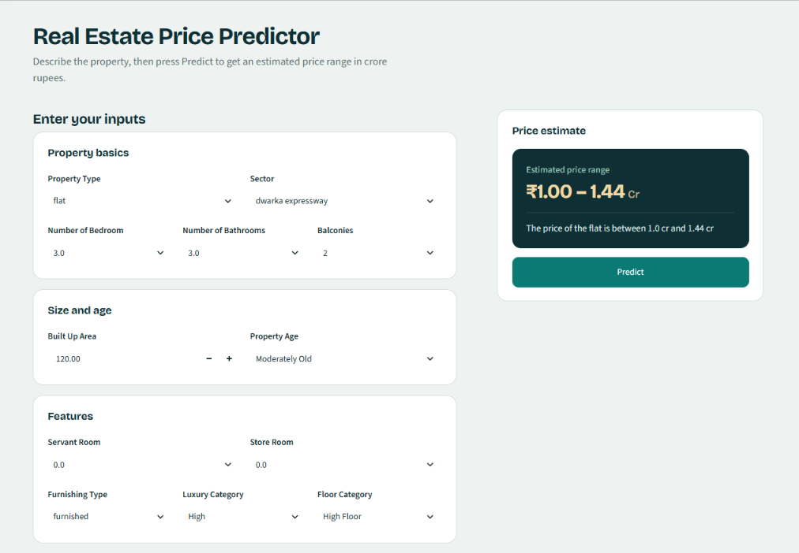
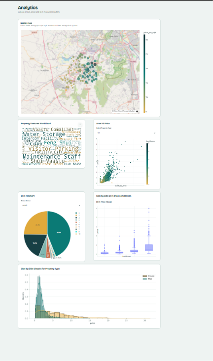
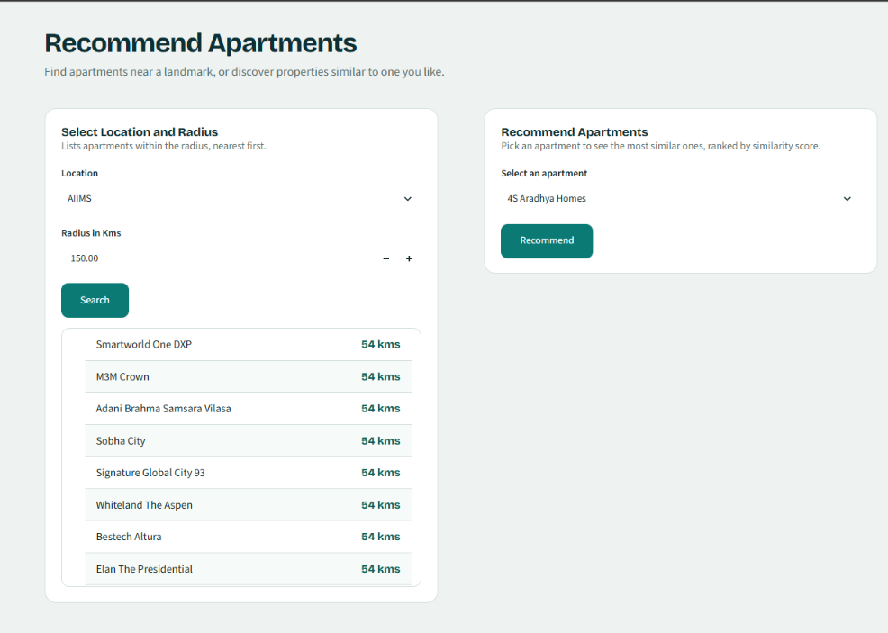

# Gurgaon Real Estate: Price Prediction, Analytics & Recommender System

An end-to-end data science project built on roughly 4,000 property listings from Gurgaon, India. It covers data cleaning, exploratory analysis, feature engineering, model comparison and deployment as a multi-page Streamlit application with three modules: a price predictor, an analytics dashboard and an appartment recommender.

## Links

- **Live demo:** [http://54.252.254.2:8501](http://54.252.254.2:8501)
- **Repository:** [SimranGirii/Real-Estate-project](https://github.com/SimranGirii/Real-Estate-project)

## Key features

| Module | What it does |
|---|---|
| **Price Predictor** | Returns an estimated price range in ₹ crore from property type, sector, bedrooms, bathrooms, balconies, built-up area, property age, servant/store rooms, furnishing, luxury category and floor category. |
| **Analytics Dashboard** | Sector price map, amenities word cloud, area-vs-price scatter plot, BHK distribution, price comparison by bedroom count and price distribution by property type. |
| **Apartment Recommender** | Finds apartments within a chosen radius of a landmark, and recommends similar societies using facilities, price/configuration data and location features. |

An additional **insights analysis** (linear-model coefficient interpretation) exists as a notebook, `notebooks/insights-module.ipynb`. It is not yet a page in the Streamlit app.

## Screenshots

**Price Predictor**



**Analytics Dashboard**



**Apartment Recommender**



## Dataset

- About 4,000 Gurgaon listings, collected as separate flat and house datasets and merged into one table. The final modelling dataset has about 3,554 records.
- Fields include price, area, BHK, bathrooms, balconies, floor, age/possession, furnishing details, facilities and nearby locations.

## Technical workflow

1. **Preprocessing:** separate cleaning pipelines for flats and houses, then merged into a single dataset.
2. **Exploratory analysis:** univariate and multivariate analysis, plus visualisation of prices and sectors.
3. **Feature engineering:** features derived from raw listing text and structured columns (for example furnishing type, luxury category and floor category).
4. **Outlier treatment and missing-value imputation:** applied before modelling.
5. **Feature selection:** several selection techniques compared, including SHAP-based analysis.
6. **Model comparison:** baseline linear models, tree ensembles and gradient boosting, evaluated with cross-validation and a held-out test set. The target is log-transformed for modelling.
7. **Deployment:** the final scikit-learn pipeline and supporting artefacts are served through Streamlit.

### Contributions

- Built the full workflow end to end, from raw listings to a deployed app.
- Combined and cleaned two differently structured datasets (flats and houses).
- Compared encoding strategies and model families, and kept experimental results separate from the deployed model.
- Developed a content-based recommender and a multi-page analytics interface.

## Model performance

Figures below are as reported from the modelling experiments (cross-validated R², held-out MAE on the original ₹ crore scale).

| Model | Encoding | CV R² | Test MAE (₹ crore) |
|---|---|---|---|
| Random Forest | Target encoding | ~0.900 | ~0.454 |
| Extra Trees | Target encoding | ~0.902 | ~0.454 |

Extra Trees scored marginally higher in cross-validation, but the two models are practically tied on test MAE. The **deployed** pipeline is a Random Forest Regressor with 500 trees, saved as `pipeline.pkl`.


## Recommender system

The recommender is content-based. Societies are represented by three feature sets, each used to compute a cosine similarity matrix:

- **Facilities:** text features extracted from each society's amenities (`feature_text.pkl`, `cosine_sim1.pkl`)
- **Price and configuration:** price ranges and property details (`cosine_sim2.pkl`)
- **Location:** nearby points of interest (`cosine_sim3.pkl`), plus a distance table (`location_distance.pkl`)

Given a society, the app returns the most similar ones ranked by similarity score. The app also offers a landmark search that lists apartments within a chosen radius, nearest first.

## Technology stack

Python, pandas, NumPy, scikit-learn, category_encoders, XGBoost, SHAP, statsmodels, Matplotlib, Seaborn, Plotly, WordCloud, Streamlit, Jupyter.

## Repository structure

```text
.
├── notebooks/            # Preprocessing, EDA, feature engineering, selection,
│                         # model selection, visualisation, recommender, insights
│                         # (also contains raw and intermediate CSV datasets)
├── streamlit_app/
│   ├── Home.py           # App entry point
│   ├── ui_theme.py       # Shared UI styling
│   ├── pages/            # Predictor, analytics and recommender pages
│   └── .streamlit/       # Streamlit configuration
├── assets/screenshots/   # README images
├── .gitattributes
└── .gitignore
```


## Getting started

Requirements: Python 3.x. No `requirements.txt` is provided yet, so install the libraries listed in the technology stack. Use the same scikit-learn version the pipeline was trained with, because pickled models can fail to load across versions.

```bash
git clone https://github.com/SimranGirii/Real-Estate-project.git
cd Real-Estate-project/streamlit_app
pip install streamlit pandas numpy scikit-learn category_encoders plotly matplotlib seaborn wordcloud
streamlit run Home.py
```
**Note on the model file:** `pipeline.pkl` (the trained price-prediction pipeline) is too large for a normal GitHub upload and is not included in this repository. To run the predictor locally, either download it from [DOWNLOAD_LINK] and place it in `streamlit_app/`, or regenerate it by running `notebooks/model-selection.ipynb`. The analytics and recommender pages do not depend on it.

Run the command from inside `streamlit_app/` so the app can find its model and data files. The notebooks read and write CSV files using relative paths, so run each one from within `notebooks/`. Not all notebooks have been verified to run without additional setup.

## Limitations and disclaimer

- Listing prices are asking prices, not verified transaction prices.
- The model learns from about 3,500 listings from one city and may be less reliable for rare sectors, unusual property types or luxury outliers.
- The predictor outputs a price range, not an exact price. Predictions are statistical estimates. They are **not** a professional valuation or financial advice.
- The recommender uses content similarity only. It does not use user behaviour or live market data.
- The insights analysis is not yet integrated into the app.

## Author

**Simran Giri**, BTech Computer Science Engineering (AI/ML)

- GitHub: [SimranGirii](https://github.com/SimranGirii)
- LinkedIn: [Simran Giri](https://www.linkedin.com/in/simran-giri-206710356)

